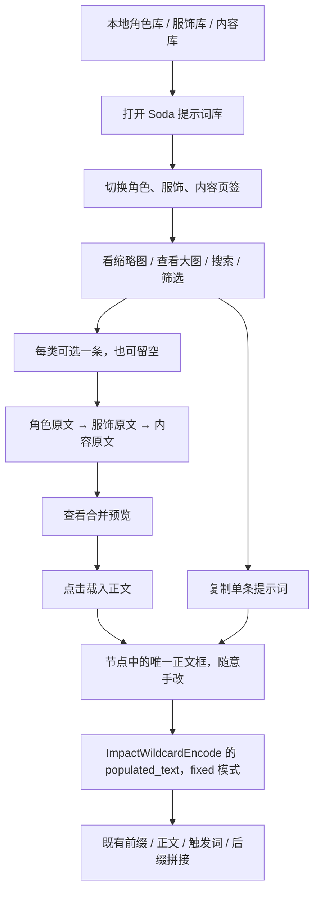

# Soda 提示词库节点开发计划

项目：ComfyUI-Soda-Prompt-Library

首版：0.1.0

更新日期：2026-11-01

本文记录讨论后确认的方案。早期需求稿中与本文冲突的自动裁衣、额外输出、自动改写和失效后清空正文等设计，不属于本版范围。

## 1. 目标与工作流位置

让角色、服饰和内容从大量词条中更容易找到：看图、搜索、筛选，选好后预览组合，再载入正文手改。

先在 Anima 的独立工作流副本中试点，保留原有“前缀、正文、后缀”组织方式和四选一模式开关。新节点归属现有“模式 · 3 prompt”组，不增加第五个开关。

画风继续由 Aaalice / Neons 等现有节点送往质量与前缀。新节点读取这些库中的角色和服饰分类，让它们可以作为正文素材使用；不删除或搬走原库。



## 2. 节点与 UI

节点名：`Soda 提示词库`，类型：`SodaPromptLibrary`，菜单分类：`Soda/Prompt`。

画布上只有一个“打开库…”按钮、一个可编辑正文框、一个正文 STRING 输出。不开多个角色框或服饰框，不加模式开关。

弹出面板包含：

- 角色 / 服饰 / 内容三个页签。
- 搜索、数据源选择、分类与筛选。内容支持族、场景、机位、焦段等元数据筛选。
- 缩略图卡片、名称与分类；选中后可查看大图和原始提示词。
- 当前组合：每类最多一条，可单独移除，也可只选其中一类。
- 只读合并预览、“复制提示词”和“载入正文”按钮。
- 内容页的“随机一条”：只在当前筛选结果内随机，覆盖全部匹配页。
- 刷新库和数据源状态。

每页最多 60 张卡片，图片延迟加载。初次 500–1200 条内容库不需要一次全部显示；现有几万条角色库同样分页。

## 3. 使用逻辑

1. 初次构图时，角色、服饰、内容可以先全部选好。
2. 合并顺序固定为角色 → 服饰 → 内容，中间用空行隔开；未选类别跳过。
3. 用户查看预览后点击“载入正文”。有不同正文时，先确认是否整段替换。
4. 后续修改主要在正文框中进行。
5. 想换一件衣服或一个角色时，可以在库中复制单条原文，再自行选择并替换正文的对应部分。

节点不识别正文中的哪个词属于哪个人物，不自动剥离角色原文自带的衣服，也不清理重复人数、重复外观、冲突词或质量词。这些由用户在正文中手改。

## 4. 多人边界

多人角色和服装的对应关系交给现有 VRP 分区流程处理。这个节点只提供素材浏览、复制和普通正文组合，不能保证 A 穿 A 的衣服、B 穿 B 的衣服。

多人物内容可以作为一整条原文读取；节点不会自动把它拆成多个人物槽位。

## 5. 快照与更新

- 载入后的正文保存在节点文本中，随工作流保存。
- 当时选择的素材原文和来源标识另存为组合快照，方便再次打开面板。
- 修改正文仅影响本次工作流，不写回源库。
- 库中的条目更新、删除或暂不可用，不会自动改写或清空已保存正文。
- 重新点选卡片才使用库中当前版本；重新载入会明确提示替换正文。
- 预览图片使用本地源文件，不把图片二进制嵌入工作流；移动库后需要重新配置图片路径。
- 热重载在浏览请求时检查源文件变更，也提供“刷新库”。执行节点时直接输出保存的正文，不重新拼库。

## 6. 数据格式与图片

使用 UTF-8 JSON。按族拆成多个文件，放入配置的数据目录；首版扫描该目录直接包含的 `*.json` 文件，不递归扫描备份目录。

```json
{
  "schema": 1,
  "family": "daily/garden",
  "label": "日常 · 庭院",
  "entries": [
    {
      "id": "garden_001",
      "title": "庭院浇花",
      "text": "one adult person, solo, watering flowers, garden, morning light",
      "preview": "garden_001.webp",
      "ver": 1
    }
  ]
}
```

优先使用完整 `text`，保持原文。兼容早期契约的 `subject` 与 `tags` 字符串：未提供 `text` 时按 `subject + ", " + tags` 合并。

每条可增加 `scene`、`camera`、`focal`、`intensity`、`undress` 作为筛选信息。保留 `nl`、`negative`、`seed` 等原文件字段，不要求删除；本版不自动输出、翻译或拼接这些字段。

图片建议 WebP，宽度 512px，文件名与 ID 对应。也接受 PNG / JPG / GIF。`preview` 是相对图片目录的路径；无图可填 `null`，面板显示“暂无预览”。角色、服饰和内容三类都支持缩略图和大图。

ID 使用小写字母、数字、下划线，在同一数据源的所有 JSON 中唯一。修订条目时保持 ID，增加 `ver`。不同数据源通过来源 ID 区分。

库内容和预览图片由数据侧提供。节点不生成预览图、不调用模型、不联网下载素材。

## 7. 现有库接入

- Aaalice：只读 SQLite，按顶层角色 / 服饰分类及其子分类读取，同时读取原有 assets 图片。
- Neons：必须明确指定哪些 family 属于角色或服饰。没有映射的画风类不会自动进入正文库。
- 自有 JSON：配置为角色、服饰或内容数据源。可直接引用外部目录，无须搬迁所有旧库。
- 每个来源独立报告状态，损坏 JSON 文件或无效条目尽量局部跳过；配置错误保留上次索引。

## 8. Anima 试点接线

新节点放在“模式 · 3 prompt”组内，位于传统正文节点上方。

将新节点正文输出连接到 ImpactWildcardEncode 的 **populated_text** 输入，将其模式设置为 **fixed**。这是 Impact 实际执行时读取的文字输入。只接 wildcard_text 可能让实际执行继续使用旧的 populated_text。

接入后手改位置为新节点正文框。原有后续连线、前缀、触发词、后缀及 VRP 路由保持原有用途。既有 Impact 仍按它自己的规则处理通配符或 LoRA 标签；新节点本身输出原文。

创建独立 Anima 试点副本，保留原工作流。完整生成验收需与用户另行安排；开发验证不默认启动 GPU 出图。

## 9. 交付与验收

公开 GitHub 仓库：`ComfyUI-Soda-Prompt-Library`。

提交节点源码、通用示例、数据格式说明、安装和接线说明、自动化检查。个人库、图库、配置、完整个人工作流和本地测试资料不进入公开仓库。

验收覆盖：

- 三类素材选择、搜索、分类、分页与当前筛选结果内随机。
- 缩略图、查看大图、缺图占位和图片路径边界。
- 原文组合、复制、载入、取消替换和手改。
- 保存 / 重开 / API 导出后文字不变。
- 源库更新和删除不覆盖正文快照。
- 无效文件 / 无效配置处理，以及 1200 条索引规模。
- Anima 副本接线检查；独立 CPU 服务中的文本节点执行。

画面质量、多人绑定和 GPU 生成不是文本节点自动测试可以证明的结论。
